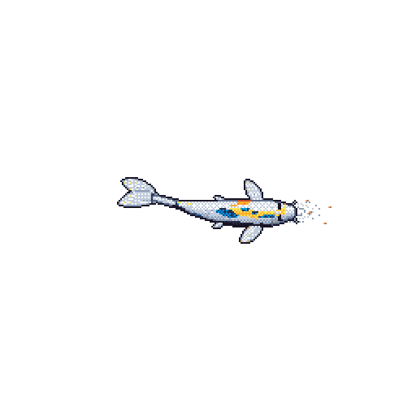

- 👋 Hi, I’m @dewminawijekoon
- 👀 I’m interested in FOSS and automotive. I like to find problems and answer them.
- 🌱 I’m currently learning in the Department of Computer Science and Engineering, University of Moratuwa
- 📫 You can reach me on LinkedIn @dewmina-wijekoon

  

<!---
dewminawijekoon/dewminawijekoon is a ✨ special ✨ repository because its `README.md` (this file) appears on your GitHub profile.
You can click the Preview link to take a look at your changes.
--->
